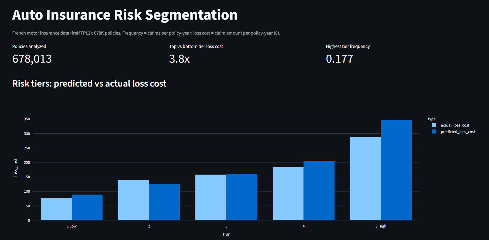
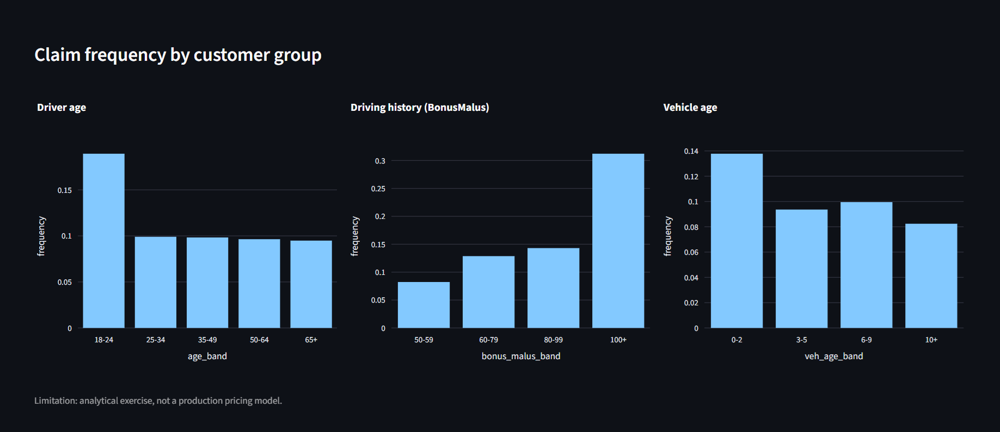

# Auto Insurance Risk Segmentation

Segmenting 678K French motor insurance policies into risk tiers using SQL, Python, and regression models, with an interactive Streamlit dashboard.




## Problem

Which policyholder and vehicle characteristics drive how often claims happen and how costly they are, and can policies be grouped into risk tiers that separate low-risk from high-risk customers?

## Data

French motor third-party liability dataset (freMTPL2): 678,013 policies and 26,639 claim records, loaded from OpenML. Key fields: claim count, exposure (fraction of a year insured), driver age, vehicle age, BonusMalus (driving history score), vehicle power, fuel type, brand, area, density, and region.

**Cleaning steps**
- Capped claim counts at 4 and exposure at 1 year so rare extreme records do not dominate.
- Capped individual claim totals at 200,000 so a few huge claims do not distort the severity model.
- Summed multiple claim rows per policy, then joined claims to policies (policies without claims get an amount of 0).
- Removed stray quote characters from text columns.
- For modelling: capped BonusMalus at 150, grouped driver age into bands, and log-transformed population density.

**Definitions:** *Exposure* = fraction of a year the policy was active. *Frequency* = claims per policy-year. *Loss cost* = claim amount per policy-year (€).

## Approach

1. **SQL analysis (SQLite):** loaded the cleaned data into a database and calculated frequency and loss cost by driver age, vehicle age, and BonusMalus band (`sql/analysis.sql`).
2. **Frequency model:** Poisson regression with exposure weights, predicting claim frequency per policy.
3. **Severity model:** Gamma regression on policies with claims, predicting average cost per claim.
4. **Risk tiers:** expected loss = predicted frequency x predicted severity; the 30% test set (random split, seed 42) was divided into 5 equal-sized tiers.
5. **Dashboard:** Streamlit app summarizing tiers and customer groups.

## Key findings

- **Overall:** claim frequency is 0.10 claims per policy-year (about 1 claim every 10 years) and loss cost is €145.58 per policy-year.
- **Driver age:** the 18-24 group has the highest claim frequency (0.19), 2.0 times the 65+ group (0.09), and also the highest loss cost.
- **Driving history:** policies in the BonusMalus 100+ band claim at 0.31, 3.8 times the 50-59 band (0.08).
- **Vehicle age:** claim frequency is 0.14 for vehicles aged 0-2 years and 0.08 for vehicles aged 10+ years, a 40% decrease. This may reflect that newer cars are driven more or insured more fully, so it should be read together with the other variables.
- **Frequency model:** reduced test deviance by 3.1% versus a baseline predicting the same frequency for everyone (0.6040 vs 0.6232).
- **Severity model:** did not beat the baseline (deviance 1.5974 vs 1.5901, -0.5%). Claim size is largely random with these features, so the model is only a component of the expected-loss calculation.
- **Risk tiers (test set):** the highest-risk tier has **3.8 times** the loss cost of the lowest.

| Tier | Policy-years | Actual frequency | Actual loss cost (€) | Predicted loss cost (€) |
|------|-------------:|-----------------:|---------------------:|------------------------:|
| 1 Low | 24,953 | 0.059 | 75.85 | 88.46 |
| 2 | 24,122 | 0.080 | 138.80 | 125.50 |
| 3 | 22,481 | 0.096 | 157.66 | 159.55 |
| 4 | 19,473 | 0.119 | 183.42 | 205.26 |
| 5 High | 16,437 | 0.177 | 287.20 | 345.98 |

## Limitations

- Predicted loss cost overshoots actual loss cost in the highest tier (€346 vs €287), so the model ranks risk better than it predicts exact amounts.
- Severity is hard to predict with the available features.
- Single-country dataset; only a few customer variables; no pricing, expense, or regulatory factors.
- This is an analytical exercise, not a production pricing model.

## How to run

```
pip install -r requirements.txt
jupyter notebook notebooks/01_analysis.ipynb   # or open it in VS Code
streamlit run app.py
```

The notebook downloads the dataset from OpenML on first run (internet required) and writes the summary CSVs the dashboard reads from `data/`.

## Tools

Python (pandas, NumPy, scikit-learn, Plotly, Matplotlib), SQL (SQLite), Streamlit, Jupyter.